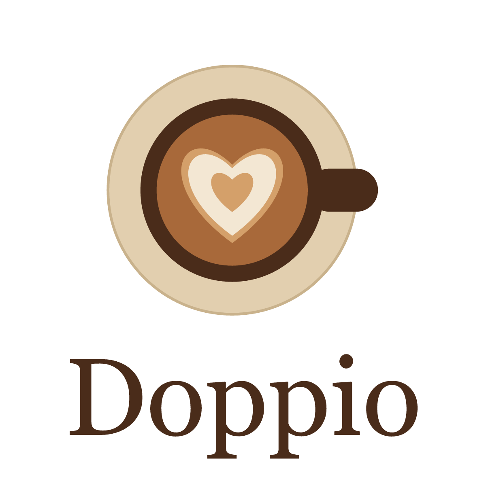

# Doppio

Doppio is a multi-page static website showcasing coffee varieties, recipes, shop info, and a simple review system. Built with HTML, CSS, and PHP for demonstration and learning purposes only — not intended for production or commercial use.

## Features
- About, Shop, Contact, Recipes pages  
- Review system saving user feedback (via PHP)  
- Coffee product images and descriptions  
- Responsive design basics  

## Installation
1. Clone or download the repo  
2. Host on a local or remote server with PHP support  
3. Access via browser  

## Notes
- No real backend or database; reviews saved locally via `reviews.json` and `save_review.php`  
- Designed as a concept/demo, not for live deployment  
- **Demo only: do not run `save_review.php` on a public server.** It writes unauthenticated, unlimited input to `reviews.json` (no login, no size limit, no file locking, no spam protection). Use it only locally.
- Concept/demo project: the company "Doppio GmbH" and its contact data are fictional.
- Only own or AI-generated images are included in this repository; recipe photos, backgrounds and other photos are placeholders.

## License
MIT License
